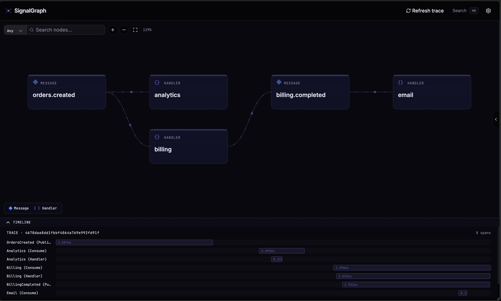
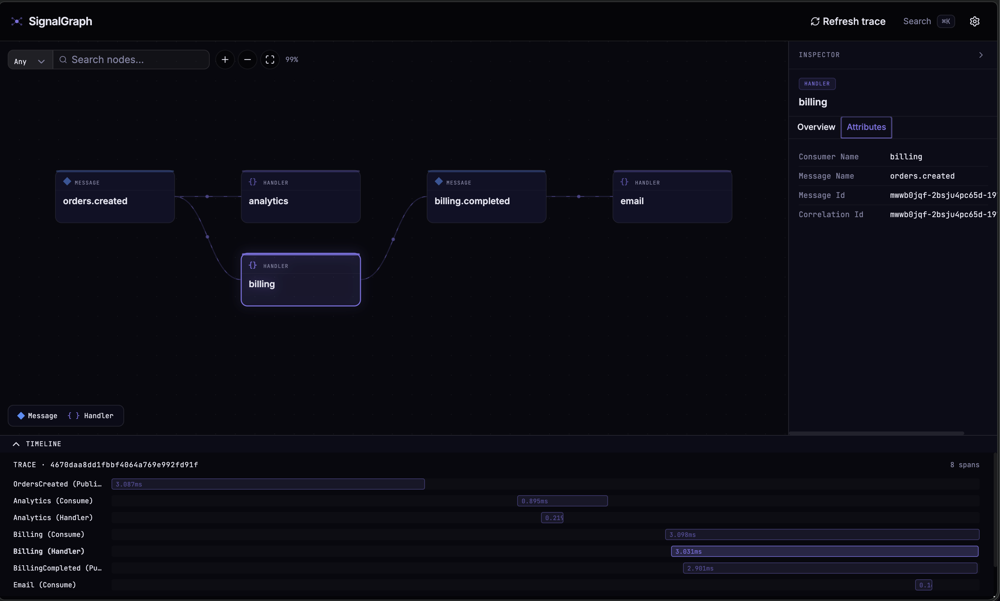

Devtools turns OpenTelemetry spans into a message-flow graph. It shows which handlers ran, which messages they published next, and how those spans line up in the timeline. Grafana Tempo is the first supported trace backend.



## Run the example

The [OpenTelemetry example](https://github.com/voffie/signalgraph/tree/main/examples/otel) includes RabbitMQ, Tempo, a publisher, and a consumer that publishes a follow-up message.

From the repository root, run `pnpm install` and `pnpm build`. Then run these commands from `examples/otel`:

```sh
pnpm generate
docker compose up -d
pnpm consume
```

Open `http://127.0.0.1:4300`. Choose **Add connection**, name it, select **Tempo**, and enter `http://localhost:3200` as the URL. If the connection is already saved, use **Search → Switch connection** to select it.

When the consumer is ready, run `pnpm send` from a second terminal in the same example directory. Wait for spans to arrive, then click **Refresh trace**. The example should show `orders.created` reaching Billing and Analytics, with Billing publishing `billing.completed` for Email.

When you're done, stop the consumer with Ctrl+C and run `docker compose down` from the example directory.

## Inspect a trace

- Click a graph node or a timeline span to inspect attributes and message IDs.
- Open **Search → Switch trace** to select a specific trace. **Refresh trace** reloads that trace. On the default page, it fetches the latest trace.
- If loading fails, check that the active Tempo connection is available and choose **Retry trace**. If the list is empty, check the lookback window in Settings and verify that both processes are exporting spans.



## Add devtools to an application

```sh
npm install @signalgraph/devtools
```

```ts
import { Devtools } from "@signalgraph/devtools";

yield* client.listen({ integrations: [Devtools()] });
```

Configure an OTLP exporter in the publisher and consumer processes. Devtools queries Tempo's HTTP API, usually on port `3200` for a local setup. The example sends spans to the separate OTLP HTTP ingestion endpoint, `http://localhost:4318/v1/traces`. Devtools does not collect spans itself.

| Option | Default | Purpose |
| --- | --- | --- |
| `host` | `127.0.0.1` | Address the devtools server binds to. |
| `port` | `4300` | Port for the devtools UI. |
| `databasePath` | `./.signalgraph/devtools.db` | SQLite file for saved connections and settings, relative to the process's working directory unless absolute. |

Keep the UI on a trusted interface. It displays trace data and saved connection details. The server runs in a separate process and shuts down when the listener scope closes.
