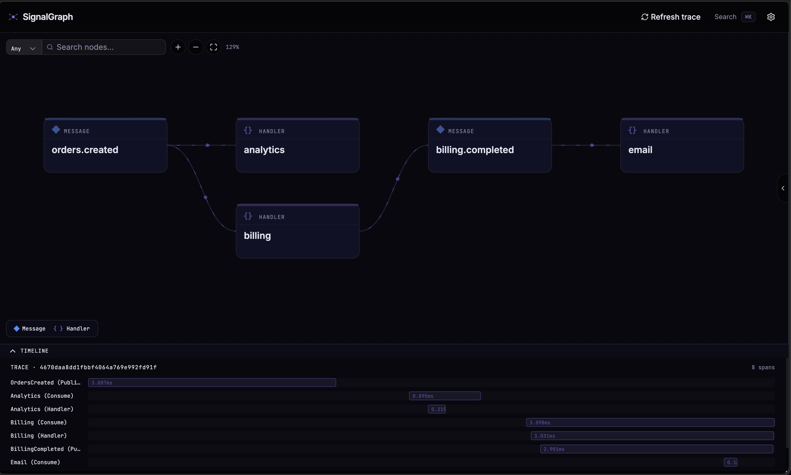

# @signalgraph/devtools

Devtools reads OpenTelemetry traces from a configured trace backend. Grafana Tempo is the first supported backend. The graph shows which handlers received a message and which messages those handlers published.



## Installation

```sh
npm install effect signalgraph @signalgraph/devtools
```

To use Tempo, configure your OpenTelemetry exporter to send traces to it. Start devtools with `client.listen({ integrations: [Devtools()] })`. Open `http://127.0.0.1:4300` and add the Tempo query URL in settings. A local Tempo instance usually serves queries on port `3200`. Set the OpenTelemetry Protocol ingestion URL in your exporter.

The devtools server listens on loopback by default and stores settings in `./.signalgraph/devtools.db`. Bind the server to a trusted interface. It displays application trace data.

Use **Refresh trace** to fetch again from the active connection. With a trace selected, this reloads that trace. On the default view, it fetches the latest trace. After a provider error, use **Retry trace**.

## Links

- [Devtools setup and trace inspection](https://signalgraph-docs.voffie.workers.dev/integrations/devtools/)
- [Report a bug or request a feature](https://github.com/voffie/signalgraph/issues)
